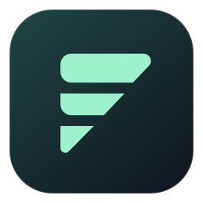
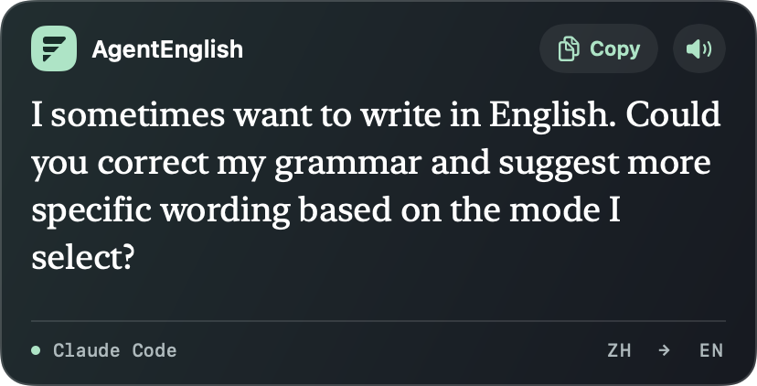

<p align="center"></p>
<h1 align="center">AgentEnglish</h1>
<p align="center">Write in your own words. See how you would say it in English.</p>

AgentEnglish is a local macOS menu bar app for people who spend their day writing prompts. Keep typing in Claude Code or Codex CLI. When you pause, a floating panel beside the terminal translates a Chinese or mixed-language draft, or edits an English draft for grammar and clarity. Your original text stays in the editor until you decide what to send.

<p align="center"></p>

## Requirements

- An Apple silicon Mac running macOS 15 or later.
- For a source install: Xcode Command Line Tools with a macOS 15+ SDK, Git, Node.js **22 or later**, and npm.
- For terminal integration: an interactive zsh session and a working installation of Claude Code or Codex CLI. Ghostty is the primary tested terminal. The bridge also recognizes Terminal.app and iTerm2.
- For Work and Everyday modes: a local Ollama installation and the model below. No translation API key is required. Your agent CLI still uses its own account.

## Install from source

1. Install Apple's developer tools if needed: `xcode-select --install`. If you use Homebrew, `brew install node ollama` installs the other tools.
2. Start Ollama with `ollama serve` if it is not already running. In another terminal, download the model (about 2.5 GB):

   ```sh
   ollama pull qwen3:4b-instruct
   ```

3. Clone the project and run the installer:

   ```sh
   git clone https://github.com/gummy789j/AgentEnglish.git
   cd AgentEnglish
   ./Install.command
   ```

   The installer builds the app, installs it in `~/Applications`, adds one marked line to your interactive zsh configuration, and starts the menu bar app. To update a source installation, run `git pull --ff-only` and `./Install.command` again.

4. Open a **new terminal tab**, enter your project directory, and run `claude` or `codex`. In the agent's prompt, type `why the tests fails when the token expire?` and pause without pressing Return. In Work mode, a typical suggestion is “Why do the tests fail when the token expires?”

If you prefer to avoid shell configuration changes, run `./Scripts/build.sh`, open `dist/AgentEnglish.app`, and launch a CLI explicitly:

```sh
./dist/AgentEnglish.app/Contents/Resources/Bridge/agent-en claude
```

## Use the panel

| Mode | Chinese or mixed-language draft | English draft |
| --- | --- | --- |
| Work | Translate into concise technical English; retain identifiers and constraints. | Fix grammar and clarify the requested action. |
| Everyday | Translate into conversational English. | Suggest natural phrasing that preserves tone and intent. |
| Apple Offline | Translate with downloaded Apple language packs. | Choose Work or Everyday for editing. |

Click the **speech-wing icon** in the menu bar to choose a mode, pause, change the delay, or enable slow speech. The panel grows with the result. Longer paragraphs scroll; **Copy** always copies the entire finished suggestion. Use the speaker button to listen. All changes are suggestions; the app never submits a prompt.

For **desktop chat apps**, choose **Enable Desktop Access** and grant AgentEnglish permission in System Settings → Privacy & Security → Accessibility. Focus the message field in Claude Desktop, ChatGPT, or Codex. Support depends on the app exposing an editable field. The app also recognizes Herder's native macOS editor; this integration has not been verified end to end. Herder terminal panes, SSH, tmux and IDE terminals are not verified.

Apple Offline requires Traditional Chinese and English under System Settings → General → Language & Region → Translation Languages. Ollama is independent of those packs. If needed, AgentEnglish starts the local Ollama server on demand. The model can unload after three idle minutes.

## Troubleshooting

| Symptom | What to check |
| --- | --- |
| No panel in a terminal | Open a new zsh tab after installation. Run `whence -w claude codex` in the shell; the launcher for the CLI you use should report `function`. Restart the CLI from that shell. |
| Panel stays ready | Type in the active CLI composer and finish selecting IME candidates. Check that the menu is not paused. New CLI layouts or a terminal that does not report tab focus can affect draft detection. |
| Model unavailable | Check `ollama list` for `qwen3:4b-instruct` and `curl http://127.0.0.1:11434/api/version`. Choose **Retry Translation** after resolving the issue. |
| Copy is dimmed | The result is still streaming or no result is available. Copy becomes active when the suggestion is complete. |
| Nothing happens in a desktop app | Check Accessibility permission for the **installed** copy of AgentEnglish. macOS may ask again after a locally signed build changes. |

## How it works

The [terminal bridge](Bridge/run.cjs) starts the real CLI in a pseudo-terminal. A headless terminal emulator follows its rendered editor, including cursor edits and bracketed pastes. The frontmost supported terminal's draft reaches the app through a per-user Unix socket. For native chat apps, [desktop field access](Sources/DesktopFields.swift) uses macOS Accessibility. Neither path registers a global keyboard monitor.

Work and Everyday send the draft to Ollama on `127.0.0.1`. The app keeps draft and suggestion in memory and writes the suggestion to the system clipboard only when you click Copy. Other software, including your CLI and clipboard manager, has its own data handling. CLI layout changes, unusually long or offscreen drafts and ambiguous paste markers can affect extraction. The Ollama path has a 6,000-character limit and an additional byte limit.

## Develop and test

See [CONTRIBUTING.md](CONTRIBUTING.md) for repository layout, offline checks and optional live CLI tests. Source builds are locally signed, not notarized for distribution. The model and agent CLIs are installed separately.

## Uninstall

Quit AgentEnglish from its menu. Delete the line ending in `# AgentEnglish` from your zsh configuration (usually `~/.zshrc`), move `~/Applications/AgentEnglish.app` to Trash, then open a new tab. This leaves Ollama, its model and your agent CLIs installed.

## License

[MIT](LICENSE). The terminal bridge uses [xterm.js](https://github.com/xtermjs/xterm.js) and [node-pty](https://github.com/microsoft/node-pty) under their respective MIT notices. The model is distributed separately under its own license.
